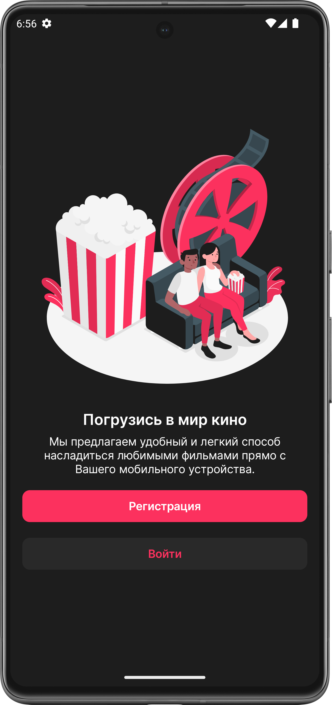
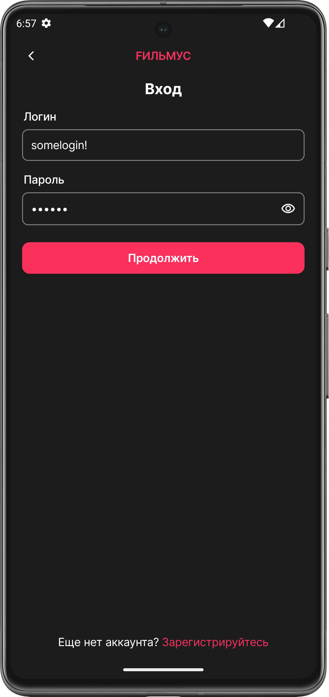
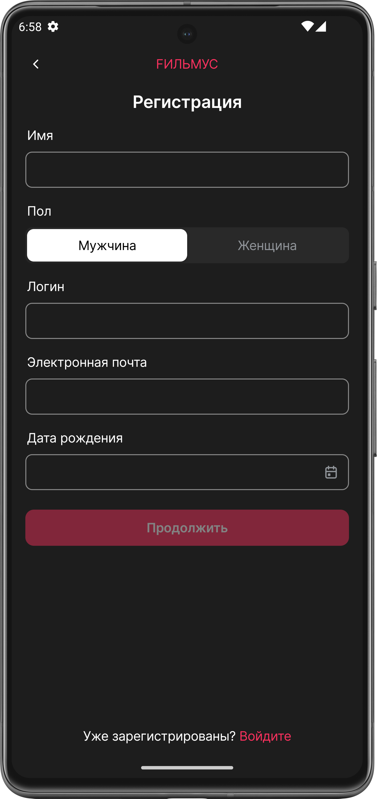
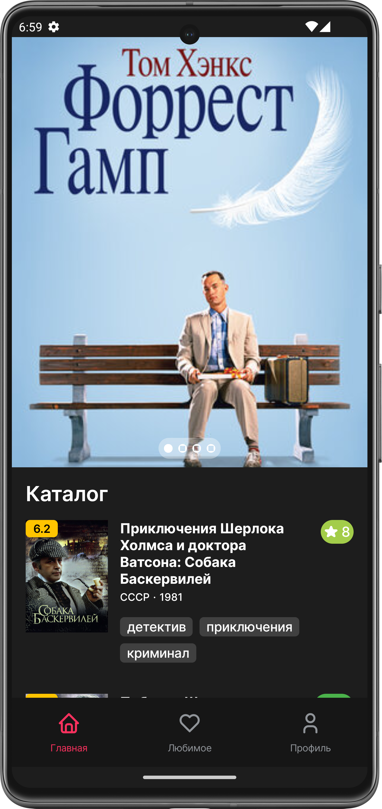
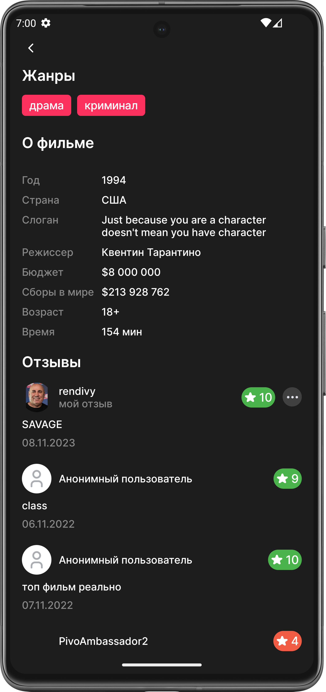
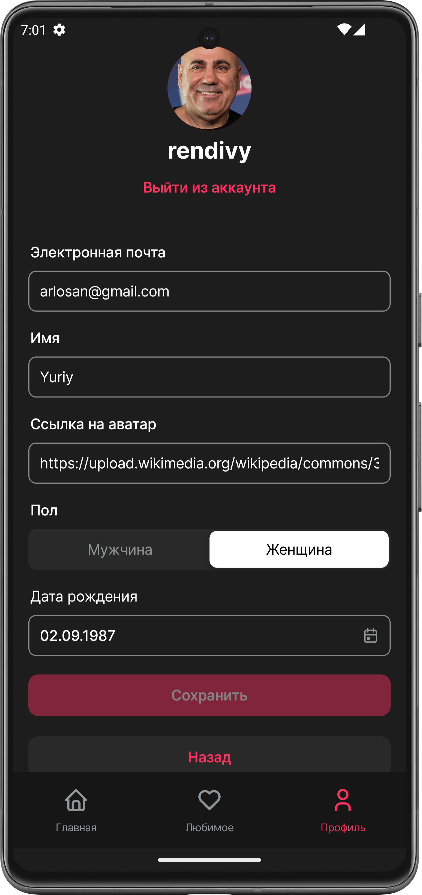

# FILMUS
Android movie catalog client: browse movies, read and write reviews, keep a list of favorites.
The app works with the `react-midterm.kreosoft.space` API of the Higher IT School web course.

## Features
- Sign up with field validation, sign in and sign out. The access token is stored in `EncryptedSharedPreferences`;
- Paginated movie list (Paging 3);
- Movie details with the average rating and user reviews;
- Add, edit and delete your own review;
- Add movies to favorites and remove them;
- View and edit the user profile;
- Movies and user ratings are cached in a Room database.

## Requirements
- JDK 17 or higher;
- Android SDK with API level 34 (`compileSdk = 34`);
- Device or emulator with Android 8.0 (API 26) or higher (`minSdk = 26`).

The project uses Gradle 8.0 (wrapper), AGP 8.1.2 and Kotlin 1.9.0.

## Build
```shell
git clone https://github.com/rendivy/FILMUS.git
cd FILMUS
./gradlew :app:assembleDebug
```

The APK is written to `app/build/outputs/apk/debug/app-debug.apk`. To build and install it on a connected device, run:

```shell
./gradlew :app:installDebug
```

The base URL is set in `common/NetworkConstant.kt`: `https://react-midterm.kreosoft.space`.

## Tech stack
- UI: Jetpack Compose, Material 3, Navigation Compose, Coil;
- Architecture: Clean Architecture (data, domain, presentation), MVVM, use cases;
- DI: Hilt;
- Network: Retrofit, OkHttp, Gson;
- Storage: Room, Paging 3, EncryptedSharedPreferences;
- Async: Kotlin Coroutines.

## Screenshots
| Greeting | Sign in | Sign up | Home |
|---|---|---|---|
|  |  |  |  |

| Movies | Movie details | Favorites | Profile |
|---|---|---|---|
|  |  |  |  |

## Limitations
- Sign in, profile, reviews and favorites depend on the course API. If `react-midterm.kreosoft.space` is unavailable,
  these features do not work.

## Feedback
To ask a question, suggest a feature or report a bug, create an [issue](https://github.com/rendivy/FILMUS/issues).
Describe your question or suggestion in the "Description" field.
If you report a bug, add the steps to reproduce it.
